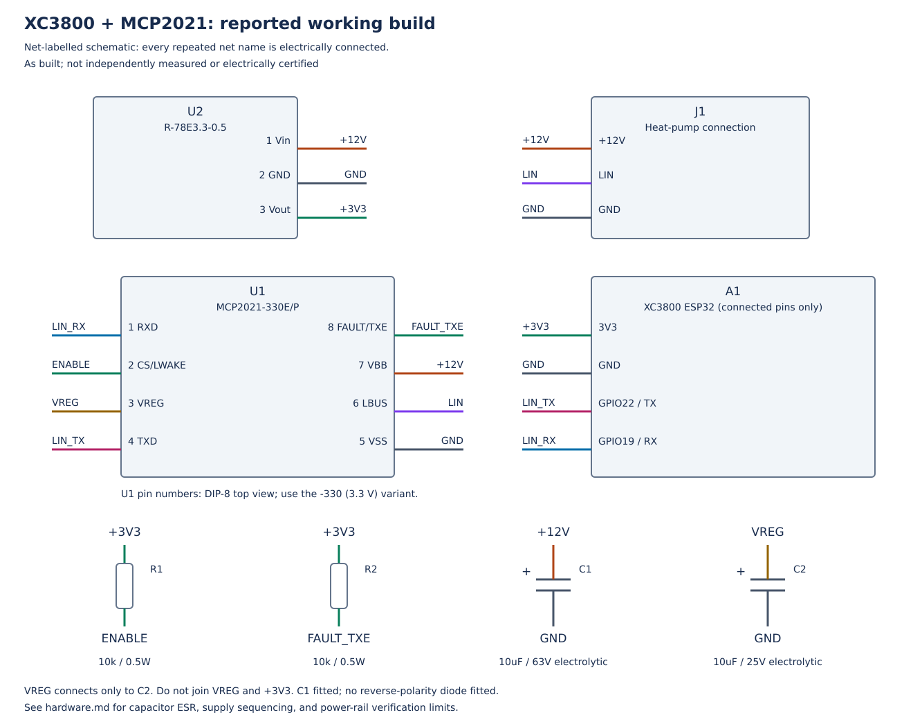
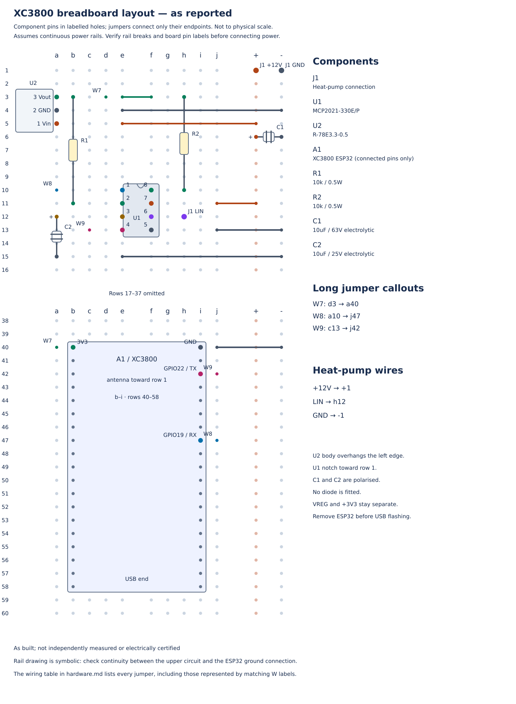

# XC3800 / MCP2021 hardware build

This guide records the owner's reported working FujiHK installation: a Jaycar
Duinotech XC3800 ESP32 board, MCP2021-330E/P LIN transceiver, and RECOM
R-78E3.3-0.5 regulator. The original Fujitsu wired wall controller remains in
place and the ESP32 acts as a **secondary controller**. See [building.md](building.md)
for the matching firmware, Linux build, flashing, and serial setup instructions.

The wiring below describes the circuit **as built**. The pin functions have
been checked against the supplied component datasheets, and the diagram tool
checks the breadboard connections against the named circuit nets. This is not
an independently measured or fully qualified hardware design. The capacitor
and supply-sequencing checks below remain open.

## Differences from upstream

| Item | Upstream reference | This build |
| --- | --- | --- |
| MCU board | M5Atom | Jaycar XC3800, ESP32-WROOM-32E, 38 pins, CP2102 USB-UART |
| Setup button | M5Atom button / GPIO39 | BOOT / GPIO0; EN is reset |
| Status pixel | GPIO27 NeoPixel | Absent; disabled in `esp32dev` firmware |
| Transceiver | MCP2025-330 | MCP2021-330E/P, DIP-8, 3.3 V regulator variant |
| External regulator | Pololu 12 V to 3.3 V | RECOM R-78E3.3-0.5, 6–28 V input, 3.3 V / 500 mA output |
| Enable pull-up | 10 kΩ to transceiver VREG | R1, 10 kΩ to external +3V3 |
| FAULT/TXE pull-up | Not applicable to MCP2025 | R2, 10 kΩ to external +3V3 |
| Transceiver VREG | Used for pull-ups | C2 only; no external load |
| Input capacitor | See upstream circuit | C1 fitted across the 12 V rails |
| Reverse-polarity diode | See upstream circuit | None fitted |
| Setup | Button or serial | Serial `S <pin>` and `W`; BOOT is also configured as the control button |

## Parts

| Reference | Quantity | Part |
| --- | --- | --- |
| A1 | 1 | Jaycar Duinotech XC3800 ESP32 development board |
| U1 | 1 | Microchip MCP2021-330E/P, DIP-8; **not the 5 V regulator variant** |
| U2 | 1 | RECOM R-78E3.3-0.5 |
| R1, R2 | 2 | 10 kΩ, 0.5 W metal-film resistor, Jaycar RR0596 |
| C1 | 1 | 10 µF, 63 V electrolytic, Jaycar RE6075; fitted input capacitor |
| C2 | 1 | 10 µF, 25 V electrolytic, Jaycar RE6070; VREG capacitor |
| — | As needed | Breadboard, jumper wires, and three connections to the heat-pump controller bus |

The 500 mA regulator rating does not establish how much spare current the
heat-pump controller supply can deliver. Verify the supply budget for another
installation. This is a record of one installation, not a compatibility claim
for every Fujitsu indoor unit or every interface marked as a communications port.

## Circuit



Every repeated net name in this diagram is connected. `+3V3` is the **external
RECOM output**; `VREG` is the MCP2021's separate internal 3.3 V regulator output.
**Do not join those two regulator outputs.** `LIN_RX` and `LIN_TX` are names for
logic signals, not additional connections to the heat-pump bus.

| Net | Connections |
| --- | --- |
| `+12V` | Heat-pump +12 V, U1 pin 7 VBB, U2 pin 1 Vin, C1 positive |
| `GND` | Heat-pump ground, U1 pin 5 VSS, U2 pin 2 GND, ESP32 GND, C1 negative, C2 negative |
| `LIN` | Heat-pump LIN wire, U1 pin 6 LBUS |
| `+3V3` | U2 pin 3 Vout, ESP32 3V3, upper ends of R1 and R2 |
| `ENABLE` | Lower end of R1, U1 pin 2 CS/LWAKE |
| `FAULT_TXE` | Lower end of R2, U1 pin 8 FAULT/TXE |
| `VREG` | U1 pin 3 VREG, C2 positive only |
| `LIN_RX` | U1 pin 1 RXD, ESP32 GPIO19 |
| `LIN_TX` | ESP32 GPIO22, U1 pin 4 TXD |

U1 RXD is a CMOS output; no additional RXD pull-up is shown or required by the
pin description. FAULT/TXE is an open-drain fault output and transmitter-enable
input. Microchip recommends an external 10 kΩ pull-up because its approximately
750 kΩ internal pull-up may be too weak (DS20002018H §1.4.9). R2 implements that
external pull-up, using the RECOM rail in this build.

## Breadboard placement



Orient the board upright with row 1 at the top. Holes `a`–`e` on each row form
one conductive strip; `f`–`j` form another, separated by the centre channel.
The `+` rail carries **12 V**, not 3.3 V. The `−` rail is ground.

The diagram and connectivity check assume each power rail is continuous over
the board's length. Some breadboards split their rails. Check continuity with
power disconnected and bridge any actual breaks so that all the intended rail
connections share their net. The omitted drawing rows 17–37 do not indicate a
physical break. Matching W callouts represent individual long jumper wires.
Crossing drawn wires connect only at their listed endpoints.

| Component | Placement |
| --- | --- |
| U2 RECOM | Pins in a3–a5: row 3 = pin 3 Vout, row 4 = pin 2 GND, row 5 = pin 1 Vin. Body overhangs the left edge. |
| U1 MCP2021 | Across the channel, rows 10–13, notch toward row 1. Pin 1 = e10; pin 8 = f10; pin 5 = f13. |
| R1 | b3 to b11 |
| R2 | h3 to h10 |
| C1 | Across the rails near row 6; positive to +12 V, negative to GND |
| C2 | Positive in a12, negative in a15 |
| A1 ESP32 | Header pins in columns b and i, rows 40–58, antenna toward row 1 |

The RECOM datasheet numbers **pin 1 = Vin, pin 2 = GND, pin 3 = Vout**.
The reported installation is rotated so pin 3 is at row 3. Do not infer pin
numbering from the regulator's upright appearance in another drawing.

### Jumper wires

| Wire | From | To | Purpose |
| --- | --- | --- | --- |
| W1 | e5 | + rail | U2 input power |
| W2 | e4 | − rail | U2 ground |
| W3 | e3 | f3 | Carry +3V3 across the channel to R2 |
| W4 | j11 | + rail | U1 pin 7 VBB |
| W5 | j13 | − rail | U1 pin 5 VSS |
| W6 | e15 | − rail | C2 negative |
| W7 | d3 | a40 | ESP32 3V3, same strip as header b40 |
| W8 | a10 | j47 | U1 RXD to ESP32 GPIO19, header i47 |
| W9 | c13 | j42 | ESP32 GPIO22, header i42, to U1 TXD |
| W10 | j40 | − rail | ESP32 GND, header i40 |

Connect heat-pump +12 V to the + rail, LIN to h12, and ground to the − rail.
The source file uses rail holes `+1` and `-1` to represent those supply-wire
connections; their row is arbitrary on a continuous rail. C1 is represented at
`+6` and `-6`.

The ESP32 hole positions reproduce the owner's board layout. Check the actual
board's **3V3, GND, GPIO19, and GPIO22 labels** before using them with another
board revision. The supplied XC3800 schematic is dated 2016 and shows 20-way
header symbols; it does not independently establish the 38-pin board's physical
row mapping. EN and BOOT are onboard buttons, not additional breadboard wires.

## Checks and limits

1. **Disconnect power before changing wiring.** Confirm the three controller-bus
   wires from the unit's documentation and measurements. Never apply 12 V to
   ESP32 3V3 or a GPIO. Verify capacitor polarity and the transceiver's -330 part
   marking before connecting the board.
2. **Use one power source.** For this build, remove the ESP32 from the breadboard
   before USB flashing. Disconnect USB before reinstalling the ESP32 and
   restoring heat-pump power. No power-selection circuit or reverse-polarity
   protection is fitted.
3. **Check C2's capacitance and ESR.** Microchip requires a VREG output capacitor
   for stability (§1.6 and Figure 2-1, printed page 25). The datasheet recommends
   at least 10 µF ceramic or 2.2 µF tantalum and also gives a stability region for
   electrolytics. The fitted 10 µF electrolytic's nominal value alone does not
   verify its ESR or effective capacitance against that region. No ESR measurement
   or part-specific ESR specification has been supplied.
4. **Check behaviour of the two 3.3 V supplies.** Pull-ups and ESP32 TXD use the
   external rail, while U1's logic is referenced to VREG. The datasheet limits
   TXD and RXD voltages to VREG + 0.3 V (§2.0); startup and shutdown sequencing
   have not been measured. Normal operation on two nominal 3.3 V rails does not
   establish compliance during all power transitions.
5. **Treat C1 as the fitted input capacitor.** It is not a substitute for the
   VREG capacitor. The RECOM datasheet gives model-specific filtering examples
   and ripple measurement conditions; the existing build has no additional
   external bypass or filter parts beyond those listed here. Supply ripple and
   transients have not been characterised.

These checks document the limits of the as-built circuit; this PR does not
prescribe or implement a hardware revision. Keep the original wall controller
and secondary-controller configuration when validating changes to this build.

## Diagram source and maintenance

The diagrams are generated SVG, with no image-generation service or CAD package
required. They replace the supplied AI-produced PNG as the maintained drawings.
The PNG included an optional diode that is **not fitted** in the reported build;
the new diagrams omit it.

- [xc3800-wiring.json](hardware/xc3800-wiring.json) lists components, pin functions,
  circuit nets, breadboard holes, jumper endpoints, and the rail assumption.
- [render-hardware.py](../scripts/render-hardware.py) generates the schematic
  and breadboard SVGs using the Python standard library.
- The wiring tables in this guide explain the same circuit for readers.

From the repository root, regenerate after an edit:

```sh
python3 scripts/render-hardware.py
python3 scripts/render-hardware.py --check
```

The checker models breadboard strips and jumper continuity and rejects shorts,
disconnected named nets, duplicate component-pin holes, and stale SVGs. It does
not simulate the electronics or check a physical breadboard. The schematic is a
net-labelled SVG, not a KiCad schematic or PCB design.

## Source documents

The owner supplied these PDFs in the workspace's separate `references` directory.
They have not been copied into this repository:

- Microchip [**MCP2021/2/1P/2P**, DS20002018H](https://ww1.microchip.com/downloads/en/DeviceDoc/20002018H.pdf): §1.4/Table 1-2 for pin functions,
  §1.4.9 for FAULT/TXE, §1.6 and Figure 2-1 for the regulator capacitor,
  and §2.0 for voltage limits. Local filename: `20002018H.pdf`.
- RECOM [**R-78E-0.5**, revision 9/2025](https://recom-power.com/pdf/Innoline/R-78E-0.5.pdf): selection guide, pin connections,
  and filtering information. Local filename: `R-78E-0.5.pdf`.
- Jaycar XC3800 manual and schematic: `XC3800_manualMain_82121.pdf` and
  `XC3800_datasheetMain_87084.pdf`. The manual identifies the CP2102 interface
  and ESP32 Dev Module board setting. Its old Arduino installation instructions
  are superseded here by [building.md](building.md).
- Owner's wiring report and reference drawing:
  `fujihk_single_breadboard_layout_r78e_flipped.png`.
